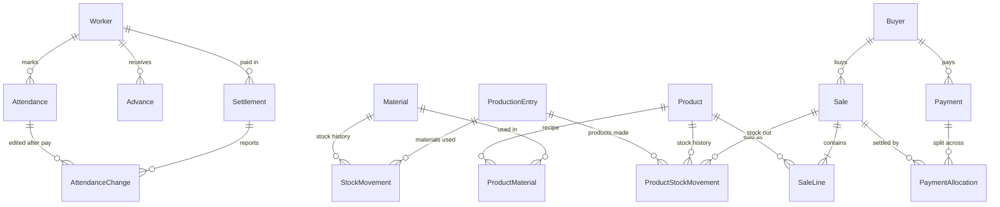

# Database design

Draft structure for all five modules. The full Prisma schema is in [database.prisma](database.prisma) and validates with Prisma 7.10.1. Each module copies its models into `MFP-backend/prisma/schema.prisma` when it is built and creates its own migration.

## Tables by module

| Module | Tables | Purpose |
|---|---|---|
| 1 Workers | `Worker` | Worker details, pay type, rate, working days per month, pay cycle |
| | `Attendance` | One row per worker per day: status, day value snapshot, bonus, earned |
| | `AttendanceChange` | Log of edits to days that were already paid |
| | `Advance` | Money given before pay day |
| | `Settlement` | Each pay day: period, summary, amount paid |
| 2 Stock | `Material` | Raw materials and supplies, unit, current quantity, low-stock level |
| | `StockMovement` | Every change to a material's stock (opening, purchase, usage, adjustment) |
| | `ProductionEntry` | The day-end entry (one per date) that groups that day's usage |
| 3 Products | `Product` | Internal name, public name, price, GST, specs, finished stock |
| | `ProductMaterial` | Recipe: material + quantity per sold unit |
| | `ProductStockMovement` | Every change to finished stock (produced, sold, cancelled, adjusted) |
| 4 Buyers | `Buyer` | Contact details, state, GSTIN, credit days, opening balance |
| | `Payment` | Money received from a buyer |
| | `PaymentAllocation` | Which sale(s) a payment settled, and how much |
| 5 Sales | `CompanyProfile` | Single row: business details printed on invoices |
| | `InvoiceCounter` | Next invoice number per financial year |
| | `Sale` | The invoice: number, buyer snapshot, totals, payment status, due date |
| | `SaleLine` | Invoice lines with public name, HSN, rate and GST snapshot |

## How they connect

## Design rules

**History tables plus running totals.** Stock changes are rows in a movements table, never silent edits to a number. `Material.currentQty`, `Product.currentQty` and `Sale.amountPaid` are kept as stored running totals for fast lists, and are updated in the **same database transaction** as the movement or payment that changes them. They can always be rebuilt from the history.

**Snapshots on transactions.** Values that must not change later are copied at the time of the transaction:
- `Attendance.dayValue`: the worker's day rate when the day was marked.
- `SaleLine.publicName`, `hsnCode`, `rate`, `gstRate`: so editing a product never changes an old invoice.
- `Sale.buyerName`, `buyerAddress`, `buyerGstin`, …: the invoice shows the buyer's details as they were.
- `Sale.type`: Tax invoice or plain Bill, depending on whether the company had a GSTIN at the time.

**Stored computed values for simple sums.**
- `Attendance.earned` = day value × (1 / 0.5 / 0) + bonus, so a worker's total earned is one `SUM`.
- Payable for a worker = Σ `Attendance.earned` − Σ `Settlement.amountPaid` − Σ `Advance.amount`.
- Buyer balance = `openingBalance` + Σ `Sale.grandTotal` (not cancelled) − Σ `Payment.amount`.

**Overdue sales.** `Sale.dueDate` (date + credit days) is stored at creation. Overdue means `paymentStatus` is not `PAID` and `dueDate` is before today. This query is indexed.

**Invoice numbers.** `InvoiceCounter` holds the last number per financial year (`2026-27`) and is incremented inside the sale transaction. Numbers have no gaps and are never reused; a cancelled sale keeps its number (`cancelledAt`) and its stock and payments are reversed.

**No hard deletes.** Workers, materials, products and buyers have `active` flags. Database relations default to *restrict*, so a row with history can't be deleted by accident. Only owned child rows cascade: sale lines with their sale, recipe rows with their product, allocations with their payment, and movements with their production entry.

**Types.**
- IDs: auto-increment integers (single user, readable in URLs).
- Money: `Decimal(12,2)`; day rates `Decimal(10,2)`; quantities `Decimal(12,3)`; recipe quantities `Decimal(14,6)`, to allow fractions like 1/24 carton.
- Business dates (attendance day, sale date, due date) are `@db.Date`, meaning dates with no time, interpreted in IST.
- Units are a shared enum: KG, G, L, ML, PCS, PACK, BOX, CARTON, BAG, ROLL, METER. Adding a unit is a small migration.

## Choices made where the module specs left questions open

These are built in so the schema doesn't need reworking later. Each can be switched off in the app.

| Open question | How the schema handles it |
|---|---|
| GST-registered or not? | `CompanyProfile.gstin` is optional; `Sale.type` = `TAX_INVOICE` or `BILL`; GST columns default to 0 |
| Prices including GST? | `CompanyProfile.pricesIncludeGst` flag; invoice lines always store the taxable value and tax separately |
| Track finished goods stock? | `Product.currentQty` + `ProductStockMovement`; they can simply be ignored if not used |
| Oversell: warn or block? | Not a schema concern; decided in the Sales service |
| Separate suppliers list? | Not now: `StockMovement.supplier` is free text; a `Supplier` table can be added later |
| Batch and expiry tracking? | Not now: can be added later as a `MaterialBatch` table linked to movements |

## Not in the database

- **Login**: single user, credentials in environment variables (no users table).
- **Files**: the logo and product photos are stored in Supabase Storage once hosted. The database stores only the URL (`CompanyProfile.logoUrl`).
- **Invoice PDFs**: generated in the app on demand from `Sale` and `SaleLine`, not stored.
